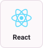
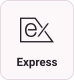
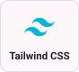
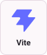
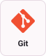

<h1 id="top">
  <picture>
    <source media="(prefers-color-scheme: dark)" srcset="assets/intro-dark.svg">
    
  </picture>
</h1>

**I'm Wazba Fatima**, a full-stack web developer based in Karachi, Pakistan.

I work across the stack with **JavaScript, React, Node.js, Express, and MongoDB**—with a natural affinity for the user interface. What keeps me engaged is following a feature from the screen back to the server: crafting layouts that feel responsive and intuitive, designing clean REST endpoints to back them, and keeping data models purposeful.

A little more about how I work

Before writing code, I like thinking through component hierarchy and state flow: where data originates, how state transitions should behave, and what errors communicate back to the user. On the frontend, that means modular React components, clean prop flow, and micro-interactions that feel natural. On the backend, it means structured route handlers, predictable schema definitions, and sensible HTTP status codes.

Most of what I build comes from curiosity about how good software feels to use. I enjoy exploring open-source repositories, finding simpler ways to structure complex interfaces, and refining my engineering habits project by project.

## Web stack

  <a href="https://react.dev/"><picture><source media="(prefers-color-scheme: dark)" srcset="assets/stack/react-lockup-dark.svg"></picture></a>
  <a href="https://developer.mozilla.org/en-US/docs/Web/JavaScript"><picture><source media="(prefers-color-scheme: dark)" srcset="assets/stack/javascript-lockup-dark.svg"></picture></a>
  <a href="https://nodejs.org/"><picture><source media="(prefers-color-scheme: dark)" srcset="assets/stack/nodejs-lockup-dark.svg"></picture></a>
  <a href="https://expressjs.com/"><picture><source media="(prefers-color-scheme: dark)" srcset="assets/stack/express-lockup-dark.svg"></picture></a>
  <a href="https://www.mongodb.com/"><picture><source media="(prefers-color-scheme: dark)" srcset="assets/stack/mongodb-lockup-dark.svg"></picture></a>
  <a href="https://tailwindcss.com/"><picture><source media="(prefers-color-scheme: dark)" srcset="assets/stack/tailwind-lockup-dark.svg"></picture></a>
  <a href="https://vite.dev/"><picture><source media="(prefers-color-scheme: dark)" srcset="assets/stack/vite-lockup-dark.svg"></picture></a>
  <a href="https://git-scm.com/"><picture><source media="(prefers-color-scheme: dark)" srcset="assets/stack/git-lockup-dark.svg"></picture></a>

More from my toolkit

JavaScript and React are my primary client-side tools, with Node.js and MongoDB when an app needs persistence and backend logic. I pay attention to how endpoints handle edge cases, clean separation of concerns, and keeping client bundles lean.

| Area | Technologies & concepts |
| :--- | :--- |
| **Frontend & UI** | React 19 · JavaScript (ES6+) · Tailwind CSS · HTML5 · CSS3 · Responsive Design |
| **Backend & APIs** | Node.js · Express.js · RESTful APIs · Route Middleware · Authentication · Error Handling |
| **Data & Storage** | MongoDB · Mongoose · Schema Modeling · CRUD Operations |
| **Workflow & Tooling** | Git · GitHub · Vite · npm · Postman · Vercel · Netlify |

**Currently exploring:** TypeScript · Next.js · advanced component patterns · performance profiling.

## Selected projects

<h3 id="thread-and-craft"><a href="https://github.com/wazbafatima/Thread-and-craft">Thread and Craft&nbsp;↗︎</a></h3>

  <strong>React · Vite · Tailwind CSS · Node.js · Express · MongoDB</strong> 
  A full-stack e-commerce platform built to deliver an immersive apparel shopping experience. Features dynamic catalog browsing with category filtering, user authentication, a persistent shopping cart, checkout workflow, and a dedicated admin panel for managing inventory and customer orders. Built with smooth scroll transitions and clean component state separation. 
  <a href="https://github.com/wazbafatima/Thread-and-craft">Source code</a> · <a href="https://github.com/wazbafatima/Thread-and-craft#readme">Project overview &rarr;</a>

<h3 id="alkhidmat-impact-hub"><a href="https://al-khidmat-web.vercel.app">Alkhidmat Impact Hub&nbsp;↗︎</a></h3>

  <strong>JavaScript · HTML5 · CSS3 · Vercel</strong> 
  A responsive community and humanitarian portal built for the Bano Qabil Alumni Meetup '26 Web Development Competition. Spotlights youth volunteer initiatives, active donation drives, and event schedules, with an emphasis on accessible semantic HTML, high performance, and smooth mobile usability. 
  <a href="https://github.com/wazbafatima/Al-khidmat-web">Source code</a> · <a href="https://al-khidmat-web.vercel.app">Live demo &rarr;</a>

<h3 id="study-planner"><a href="https://study-planner-eight-smoky.vercel.app">Study Planner&nbsp;↗︎</a></h3>

  <strong>React 19 · React Router · Tailwind CSS · date-fns · Lucide</strong> 
  A student productivity application designed to organize coursework and revision timelines. Combines task scheduling, structured notes, an integrated study session timer, and progress tracking inside a clean, distraction-free UI. 
  <a href="https://github.com/wazbafatima/study-planner">Source code</a> · <a href="https://study-planner-eight-smoky.vercel.app">Live demo &rarr;</a>

More projects: Student Feedback Portal &amp; MovieVerse

<h3 id="student-feedback-portal"><a href="https://student-feedback-portal-lake.vercel.app">Student Feedback Portal&nbsp;↗︎</a></h3>

  <strong>React 19 · Tailwind CSS · React Icons</strong> 
  An interactive feedback system for academic courses, allowing students to submit categorized ratings and reviews through a multi-step form flow with immediate client-side validation. 
  <a href="https://github.com/wazbafatima/student-feedback-portal">Source code</a> · <a href="https://student-feedback-portal-lake.vercel.app">Live demo &rarr;</a>

<h3 id="movieverse"><a href="https://movie-verse-ten-dun.vercel.app">MovieVerse&nbsp;↗︎</a></h3>

  <strong>React 19 · REST API · CSS</strong> 
  A movie discovery app that interfaces with cinema databases, featuring live search filtering, detailed modal views, and responsive layouts across viewport sizes. 
  <a href="https://github.com/wazbafatima/MovieVerse">Source code</a> · <a href="https://movie-verse-ten-dun.vercel.app">Live demo &rarr;</a>

## Let's connect

If you're building something for the web, curious about one of my projects, or want to discuss an idea, I'd be glad to hear from you.

  <a href="https://wazbaportfolio.netlify.app"><picture><source media="(prefers-color-scheme: dark)" srcset="assets/portfolio-dark.svg"></picture></a>
  <a href="https://www.linkedin.com/in/wazba-fatima"><picture><source media="(prefers-color-scheme: dark)" srcset="assets/linkedin-dark.svg"></picture></a>
  <a href="mailto:wazbakhan@gmail.com"><picture><source media="(prefers-color-scheme: dark)" srcset="assets/email-dark.svg"></picture></a>

&copy; 2026 Wazba Fatima &middot; <a href="#top">Back to top &uarr;</a>

